<p align="center">
  
</p>

<h1 align="center">Stackin MCP plugin — NF-e and NFS-e for ChatGPT, Claude, Codex, Cursor, Gemini CLI and any MCP client</h1>

<p align="center">
  Issue, consult, correct and cancel Brazilian electronic invoices (<strong>nota fiscal eletrônica</strong>)
  from any AI client that speaks the Model Context Protocol.
</p>

<p align="center">
  <a href="https://github.com/stackin-io/stackin-mcp-plugin/blob/master/LICENSE"></a>
  <a href="https://mcp.stackin.io/mcp"></a>
  <a href="https://docs.stackin.io/mcp"></a>
  <a href="https://app.stackin.io"></a>
</p>

---

Ask in plain language — *"issue an NFS-e for this service"*, *"why was my last NF-e rejected?"*,
*"cancel invoice 1042 and tell me the reason code"* — and the model does it through Stackin,
against SEFAZ and the municipal NFS-e webservices.

**Thirty-four tools, twelve skills, one hosted server.** No SDK to install, no XML to sign, no
certificate to juggle in the client.

- 🧾 **NF-e** (goods) and **NFS-e** (services) — issue, consult, cancel
- 🔎 **Diagnose a rejection** by the tax authority's own code, and choose reissue vs. correction
- ✉️ **Correction letter (CC-e)** against an authorized NF-e
- 📥 **Received invoices** — read and manifest documents other companies issued against yours
- 🔢 **Numbering invalidation** for a reserved, never-used NF-e range
- 📄 **DANFE / DANFSe PDF** straight out of the conversation
- 🔎 **Fiscal code lookup** — resolve an NCM, CFOP or CEST instead of guessing one, and confirm who a CNPJ belongs to
- 👥 **Client registry** — save a recipient once and issue to it by id, instead of retyping it every month
- 🏢 **Several companies on one connection** — list what the connection covers and pick the company per call
- 🧭 **Rejection explained** in plain words, with the field at fault, and **item classification** suggested from a description, always confirmed before use
- 📊 **Stats** — how many documents, how much billed, whether rejections are rising
- 🔔 **Webhooks** — register, list and remove endpoints, and see whether deliveries arrive

## Table of contents

- [Install](#install)
- [Authentication: OAuth or API key](#authentication-oauth-or-api-key)
- [Skills](#skills)
- [What is in this repository](#what-is-in-this-repository)
- [One plugin, five clients](#one-plugin-five-clients)
- [MCP Registry](#mcp-registry)
- [FAQ](#faq)
- [Maintainer notes](#maintainer-notes)

## Install

| Property | Value |
|---|---|
| Endpoint | `https://mcp.stackin.io/mcp` |
| Transport | `streamable-http` |
| Auth | OAuth 2.1 with PKCE and dynamic client registration, or a static Bearer key |
| Environments | Homologation and production, fixed on the key or on the authorized connection |

Every snippet below takes the same URL. Where a snippet sends a header, the key comes from an
environment variable called `STACKIN_API_KEY`; leave the header out and a client that speaks
MCP OAuth logs you in instead (see [Authentication](#authentication-oauth-or-api-key)). Each
client spells environment interpolation its own way, so copy the snippet for yours.

- [Claude Code](#claude-code)
- [Claude.ai and Claude Desktop](#claudeai-and-claude-desktop)
- [ChatGPT](#chatgpt)
- [Codex](#codex)
- [Cursor](#cursor)
- [VS Code](#vs-code)
- [Windsurf](#windsurf)
- [Zed](#zed)
- [Gemini CLI](#gemini-cli)
- [Goose](#goose)
- [From an API: xAI, OpenAI, Anthropic](#from-an-api-xai-openai-anthropic)
- [Local clients: Open WebUI, LM Studio, LibreChat, AnythingLLM, Jan](#local-clients)
- [Any stdio-only client: mcp-remote](#any-stdio-only-client-mcp-remote)

### Claude Code

The repository is its own marketplace, so the plugin installs straight from GitHub:

```bash
claude plugin marketplace add stackin-io/stackin-mcp-plugin
claude plugin install stackin@stackin
```

The plugin brings the twelve skills and points Claude Code at `https://mcp.stackin.io/mcp`.
**There is nothing to configure**: the first tool call answers 401 with `WWW-Authenticate`,
and Claude Code follows it — run `/mcp` in the session, authorize in the browser that opens,
and the token is stored for you.

Prefer a static key? Add the server by hand instead of installing the plugin (no skills then):

```bash
claude mcp add --transport http stackin https://mcp.stackin.io/mcp \
  --header "Authorization: Bearer ${STACKIN_API_KEY}"
```

### Claude.ai and Claude Desktop

**Customize → Connectors → + Add → Add custom connector**. Name `Stackin`, URL
`https://mcp.stackin.io/mcp`, then sign in when asked: the connector registers itself, so the
OAuth client fields stay empty. On Team and Enterprise, an Owner adds it under **Organization
settings → Connectors**. A connector added on claude.ai is available in Claude Desktop too.

### ChatGPT

Stackin is published as a ChatGPT app. To add it yourself in developer mode: **chatgpt.com →
Plugins → + → Add custom MCP server**, Server URL `https://mcp.stackin.io/mcp`, authentication
**OAuth**, then create it as a plugin and install it. ChatGPT has no custom-header option, so
OAuth is the only way in. The walkthrough, with video, is at
[docs.stackin.io/mcp](https://docs.stackin.io/mcp).

### Codex

```bash
codex mcp add stackin --url https://mcp.stackin.io/mcp
```

Codex runs the OAuth login when the server asks for it. With an API key instead, in
`~/.codex/config.toml`:

```toml
[mcp_servers.stackin]
url = "https://mcp.stackin.io/mcp"
bearer_token_env_var = "STACKIN_API_KEY"
```

The plugin (`.codex-plugin/` + `.app.json`) also installs in Codex from
`.agents/plugins/marketplace.json`, with the skills.

### Cursor

Install link (GitHub does not render custom-scheme links as clickable, so paste it in a
browser or put it behind a button on your own page):

```
cursor://anysphere.cursor-deeplink/mcp/install?name=stackin&config=eyJ1cmwiOiJodHRwczovL21jcC5zdGFja2luLmlvL21jcCJ9
```

`config` is the base64 of `{"url":"https://mcp.stackin.io/mcp"}`. By hand, in
`.cursor/mcp.json` (project) or `~/.cursor/mcp.json` (global) — Cursor wants `${env:VAR}`:

```json
{
  "mcpServers": {
    "stackin": {
      "url": "https://mcp.stackin.io/mcp",
      "headers": { "Authorization": "Bearer ${env:STACKIN_API_KEY}" }
    }
  }
}
```

The repository is also a Cursor plugin (`.cursor-plugin/plugin.json`), with the skills.

### VS Code

Install link (Insiders: replace `vscode:` with `vscode-insiders:`):

```
vscode:mcp/install?%7B%22name%22%3A%22stackin%22%2C%22type%22%3A%22http%22%2C%22url%22%3A%22https%3A%2F%2Fmcp.stackin.io%2Fmcp%22%7D
```

From a terminal:

```bash
code --add-mcp '{"name":"stackin","type":"http","url":"https://mcp.stackin.io/mcp"}'
```

With an API key, in `.vscode/mcp.json` — VS Code prompts for it and keeps it out of the file:

```json
{
  "inputs": [
    { "type": "promptString", "id": "stackin-key", "description": "Stackin API key", "password": true }
  ],
  "servers": {
    "stackin": {
      "type": "http",
      "url": "https://mcp.stackin.io/mcp",
      "headers": { "Authorization": "Bearer ${input:stackin-key}" }
    }
  }
}
```

### Windsurf

In Windsurf's `mcp_config.json` (open it from **Cascade → MCP servers → View raw config**).
The key is `serverUrl`, not `url`:

```json
{
  "mcpServers": {
    "stackin": {
      "serverUrl": "https://mcp.stackin.io/mcp",
      "headers": { "Authorization": "Bearer ${env:STACKIN_API_KEY}" }
    }
  }
}
```

### Zed

In `settings.json`. Leave `headers` out and Zed runs the OAuth flow:

```json
{
  "context_servers": {
    "stackin": {
      "url": "https://mcp.stackin.io/mcp",
      "headers": { "Authorization": "Bearer <your API key>" }
    }
  }
}
```

### Gemini CLI

The repository is a Gemini CLI extension (`gemini-extension.json`), with the skills:

```bash
gemini extensions install https://github.com/stackin-io/stackin-mcp-plugin
```

Or only the server:

```bash
gemini mcp add --transport http stackin https://mcp.stackin.io/mcp
```

In `settings.json`, `httpUrl` is streamable HTTP (`url` would mean SSE):

```json
{
  "mcpServers": {
    "stackin": {
      "httpUrl": "https://mcp.stackin.io/mcp",
      "headers": { "Authorization": "Bearer $STACKIN_API_KEY" }
    }
  }
}
```

### Goose

Install link:

```
goose://extension?url=https%3A%2F%2Fmcp.stackin.io%2Fmcp&type=streamable_http&id=stackin&name=Stackin&description=Brazilian%20fiscal%20documents%20%28NF-e%20and%20NFS-e%29
```

Or `goose configure` → **Add Extension** → **Remote Extension (Streamable HTTP)** → URL
`https://mcp.stackin.io/mcp`.

### From an API: xAI, OpenAI, Anthropic

These APIs call a remote MCP server on your behalf; send the key as a bearer token.

**xAI** (`POST https://api.x.ai/v1/responses`), in `tools`:

```json
{
  "type": "mcp",
  "server_label": "stackin",
  "server_url": "https://mcp.stackin.io/mcp",
  "authorization": "<your API key>"
}
```

**OpenAI Responses API**, in `tools` (`authorization` is not stored; send it every request):

```json
{
  "type": "mcp",
  "server_label": "stackin",
  "server_url": "https://mcp.stackin.io/mcp",
  "authorization": "<your API key>",
  "require_approval": "always"
}
```

**Anthropic Messages API** (MCP connector), with the header
`anthropic-beta: mcp-client-2025-11-20`:

```json
{
  "mcp_servers": [
    {
      "type": "url",
      "url": "https://mcp.stackin.io/mcp",
      "name": "stackin",
      "authorization_token": "<your API key>"
    }
  ],
  "tools": [{ "type": "mcp_toolset", "mcp_server_name": "stackin" }]
}
```

Issuing is irreversible and legally binding: keep a human approval step in front of
`issue_invoice` and `cancel_invoice` when an API drives the calls.

### Local clients

**Open WebUI** (0.6.31 or later): **Admin Settings → Integrations → External Tool Servers →
+ Add Connection**, type **MCP (Streamable HTTP)**, URL `https://mcp.stackin.io/mcp`, auth
**Bearer** with your key.

**LM Studio**, in `mcp.json`:

```json
{
  "mcpServers": {
    "stackin": {
      "url": "https://mcp.stackin.io/mcp",
      "headers": { "Authorization": "Bearer <your API key>" }
    }
  }
}
```

**LibreChat**, in `librechat.yaml` — `{{STACKIN_API_KEY}}` is asked of each user:

```yaml
mcpServers:
  stackin:
    type: streamable-http
    url: https://mcp.stackin.io/mcp
    headers:
      Authorization: "Bearer {{STACKIN_API_KEY}}"
    customUserVars:
      STACKIN_API_KEY:
        title: Stackin API key
        description: Generate one at app.stackin.io
        sensitive: true
```

**AnythingLLM**, in `<storage>/plugins/anythingllm_mcp_servers.json`. `type` is required:
without it AnythingLLM assumes SSE.

```json
{
  "mcpServers": {
    "stackin": {
      "type": "streamable",
      "url": "https://mcp.stackin.io/mcp",
      "headers": { "Authorization": "Bearer <your API key>" }
    }
  }
}
```

**Jan** documents only local (command) servers: use the `mcp-remote` bridge below as the
command.

### Any stdio-only client: mcp-remote

A client that only launches local servers reaches the hosted one through
[`mcp-remote`](https://github.com/geelen/mcp-remote). Keep the header argument free of spaces
— some clients split arguments on them — and put the space inside the variable:

```json
{
  "mcpServers": {
    "stackin": {
      "command": "npx",
      "args": ["-y", "mcp-remote", "https://mcp.stackin.io/mcp", "--header", "Authorization:${AUTH}"],
      "env": { "AUTH": "Bearer <your API key>" }
    }
  }
}
```

Without `--header`, `mcp-remote` runs the OAuth flow in a browser itself.

## Authentication: OAuth or API key

Two ways in, and they behave differently.

**An API key.** Generate one at [app.stackin.io](https://app.stackin.io); it already carries
the environment, so there is nothing to choose in the client. Send it as
`Authorization: Bearer <key>`.

**OAuth, with no key at all.** Leave the header out: a tool call answers 401 with
`WWW-Authenticate` pointing at `/.well-known/oauth-protected-resource`, which is what makes
Claude Code offer to log in when you run `/mcp`. The server supports dynamic client
registration (`/oauth/register`), so a client that registers itself gets a `client_id` without
anyone being asked. Cursor can also hold static client credentials under an `auth` key instead
of registering dynamically.

The browser leg has been completed from ChatGPT and from Claude Code (the plugin's
`.mcp.json` carries no header, so every call it makes runs on an OAuth token). If a client
stops midway, look at the `redirect_uri` it uses: `/oauth/authorize` only accepts a URI the
client registered.

## Skills

A skill exists only where the order of operations, or a fiscal rule, adds something a tool
description cannot carry on its own.

| Skill | What it carries |
|---|---|
| `issue-invoice` | Which document the situation needs, checking the company is ready, looking the recipient up in the client registry, and validating before issuing |
| `consult-invoice` | Finding a document, which identifier each operation takes, and counting with `invoice_stats` |
| `cancel-invoice` | Confirming before an irreversible act, and when a correction letter is the right tool instead |
| `diagnose-invoice` | Reading the tax authority's own rejection code, `explain_rejection`, and choosing between reissue and correction |
| `correct-invoice` | Filing a correction letter against an authorized NF-e, and what a CC-e may not change |
| `invalidate-numbering` | Checking what was already declared, then declaring an NF-e range reserved and never used |
| `received-invoices` | Reading documents other companies issued against this one, and answering them |
| `fiscal-lookup` | Resolving an NCM, CFOP or CEST before issuing, and treating a `classify_item` suggestion as one |
| `taxpayer-lookup` | Confirming who a tax id belongs to, and why a 404 is not an invalid CNPJ |
| `manage-clients` | Finding, saving and fixing the company's saved clients, and why a duplicate is refused |
| `select-company` | Choosing which company a call acts for when one connection covers several |
| `manage-webhooks` | Registering an endpoint once, never echoing its secret, removing one, and reading its deliveries |

## What is in this repository

This repository is the **distribution layer**: the manifests, the skills and the assets. The
server itself lives at `https://mcp.stackin.io/mcp` and speaks the Model Context Protocol.

| Path | What it is |
|---|---|
| `.codex-plugin/plugin.json` | Plugin identity, version, category, legal links |
| `.app.json` | Maps the plugin to the registered MCP connection |
| `.agents/plugins/marketplace.json` | Local marketplace, for installing before publishing |
| `.claude-plugin/plugin.json` | Plugin identity for Claude Code |
| `.claude-plugin/marketplace.json` | This repository as a marketplace Claude Code can add |
| `.mcp.json` | The hosted MCP server, for Claude Code |
| `.cursor-plugin/plugin.json` | Plugin identity for Cursor |
| `mcp.json` | The hosted MCP server, in Cursor's format |
| `gemini-extension.json` | Gemini CLI extension: the hosted server and `GEMINI.md` as context |
| `GEMINI.md` | The skills and the rules every call follows, for Gemini CLI |
| `server.json` | The MCP Registry entry |
| `skills/` | The twelve workflows that need more than a tool description |
| `assets/` | Icon and logo |
| `scripts/` | `check_skills.py` (skills against the live server), `check_manifests.py` (every manifest, the app id, one version) |

## One plugin, five clients

Each ecosystem looks in its own place, and each one fails silently when its file is missing
or wrong:

| Client | Looks for | What it reads |
|---|---|---|
| ChatGPT / Codex | `.codex-plugin/plugin.json` + `.app.json` | the app id and the hosted MCP |
| Codex marketplace | `.agents/plugins/marketplace.json` | this repo as a source |
| Claude Code | `.claude-plugin/marketplace.json`, `.claude-plugin/plugin.json`, `.mcp.json` | the skills and `https://mcp.stackin.io/mcp` |
| Cursor | `.cursor-plugin/plugin.json`, `mcp.json` | the skills and the server, in Cursor's format |
| Gemini CLI | `gemini-extension.json`, `GEMINI.md` | the server (`httpUrl`), the context file and `skills/` |

Adding the folder to Claude Code failed with *"No marketplace manifest found …
(expected .cursor-plugin/marketplace.json or .claude-plugin/marketplace.json)"* until the
Claude row existed. The skills are shared: every manifest points at `skills/`, so a skill
written once is read by every client. `scripts/check_manifests.py` runs in CI and fails on an
empty app id, a logo that does not exist, or manifests that disagree on the version.

## MCP Registry

`server.json` describes the hosted server for the
[official MCP Registry](https://registry.modelcontextprotocol.io) as a remote entry —
`io.github.stackin-io/stackin`, `streamable-http`, no package to install.

Publishing is automated: pushing a `v*` tag runs `.github/workflows/publish-mcp.yml`, which
stamps the version from the tag, authenticates with **GitHub OIDC** (no stored token — the
workflow's own identity is what grants the `io.github.stackin-io/*` namespace) and publishes.

```bash
git tag v1.0.0 && git push origin v1.0.0
```

The registry lists the *public* repository, which is why the entry lives here and not beside
the server's own source.

## FAQ

**Do I need a digital certificate (A1/A3) in the client?** No. The certificate is uploaded
once at [app.stackin.io](https://app.stackin.io) and stays server-side.

**Does it work in production, or only homologation?** Both. The environment is fixed on the
API key, or on the connection you authorized over OAuth — there is nothing to pick per call.

**Which municipalities are supported for NFS-e?** The ones Stackin covers; consult
[docs.stackin.io](https://docs.stackin.io). NF-e is nationwide through SEFAZ.

**Can I use the server without this plugin?** Yes — it is a plain MCP server. The plugin only
adds the skills and saves you the manual configuration.

**Is it free?** Issuing consumes credits from your Stackin account. Consulting and cancelling
do not. Received NF-e are included up to 50 a month; past that, each new one costs R$ 0,05
of credit (`get_usage` shows where the account stands).

**The code lookups answered 403 and now they do not. What changed?** Until 2026-09-10
those four routes carried no OAuth scope, so an authorized app was refused whatever it had
been granted. They now need `invoice:read`, which every connection already holds — a
connection made before that date works without being remade.

**A CNPJ I know is valid comes back 404 from `lookup_taxpayer`. Is it wrong?** Probably not.
That registry reloads monthly from the Receita Federal's dump, so a company registered in
the last few weeks is not in it yet. It is not a validity check, and nothing should block an
invoice over it.

## Maintainer notes

The app id in `.app.json` was filled on 2026-09-06, once `mcp.stackin.io` was registered in
OpenAI Developer Mode and a real connector completed the OAuth authorisation.

**The id was empty from 2026-09-08 to 2026-11-20.** Reshaping `apps` from a list into the
object Codex reads (`{"apps": {"stackin": {"id": "asdk_app_…", "category": "…"}}}`, parsed by
`codex-rs/connectors/src/plugin_config.rs`) left `id` as `""`, and Codex drops an app with an
empty id with only a log warning. `check_manifests.py` now fails the build on it.

**A stale tool list was fixed by creating a new app, not by rescanning.** The first app
(`asdk_app_6a9d458d…`) had been scanned before the NFS-e restriction and kept advertising the
old surface. `.app.json` names the second one; if a third is ever created, this file is
the thing to update, and nothing warns you when it is wrong.

**NF-e came back on 2026-09-07, in two steps.** First `document_type` widened to accept `nfe`
on the existing eight tools — a change the count could not reveal. Then the four NF-e-only
operations came back: `correct_invoice`, `invalidate_numbering`, `list_received_invoices` and
`manifest_received_invoice`. **Twelve tools then**, seven skills.

**The four lookup tools landed on 2026-09-10**: `lookup_fiscal_code`,
`search_fiscal_codes`, `list_fiscal_kinds` and `lookup_taxpayer`, with the
`fiscal-lookup` and `taxpayer-lookup` skills. **Sixteen tools then**, nine skills. They shipped refusing every OAuth
token, because their routes carried no scope at all; `invoice:read` was granted to them on
the same day, so nothing has to be reconnected.

**Several companies on one connection, 2026-11-16** (server v0.3.0). A connection authorized through the
consent screen may cover more than one company. `list_authorized_companies` lists them with
their permissions, and every tool that touches a company's documents takes `company_id` or
`company_tax_id`; a connection with a single company needs neither. The plugin only caught up
with it a day later, with the `select-company` skill.

**The client registry landed on 2026-11-17** (server v0.6.0): `list_clients`, `get_client`
and `save_client`, and `issue_invoice` taking `client_id` and `update_client`. A new
recipient is saved as a client after a successful issuance. **Twenty tools now**, eleven
skills — `manage-clients` and `select-company` are the two new ones, and `issue-invoice` now
looks the recipient up before typing it.

**Usage, received sync and client lifecycle landed on 2026-11-18** (server v0.8.0):
`get_usage` (plan, invoices and received NF-e used, credit left), `sync_received_invoices`
(asks the SEFAZ now; one-hour wait after catching up), `deactivate_client` and
`reactivate_client`, and `list_invoices` filtering by `external_reference`.
`list_clients` takes `inactive` instead of `include_inactive`. **Twenty-four tools now.**

**Ten more on 2026-11-20** (server v0.9.0): `explain_rejection`, `classify_item`,
`get_company_readiness`, `invoice_stats`, `search_cities`, `list_invalidations`,
`list_webhooks`, `create_webhook`, `delete_webhook` and `list_webhook_deliveries`, and
`issue_invoice` taking `discount`, `issued_at` and `contingency`. The webhook tools need
`webhook:manage`, a step-up scope the client asks for on first use rather than at connect.
**Thirty-four tools now**, twelve skills — `manage-webhooks` is the new one.

**The connector caches the tool list from the moment it was scanned.** The app was authorized
at 10:48 on 2026-09-06 and the NFS-e restriction went live at 12:00, so ChatGPT kept
advertising eleven tools — including three the server no longer has. Publishing a new plugin
version and running **Scan Tools** is what refreshes it; the fix is not on the server, which
was already correct. Check the count before testing anything: the server is the truth, and
`scripts/check_skills.py` reads it live.

**Read the identifier off the connector page, not out of the URL.** The address is
`chatgpt.com/plugins/plugin_asdk_app_…`, and `plugin_` there is part of the route, not of the
id. The page's own "App ID" field is the value that belongs here — `asdk_app_…`. Getting that
wrong is silent: nothing validates it until a submission fails.

## License

MIT — see [LICENSE](LICENSE).
